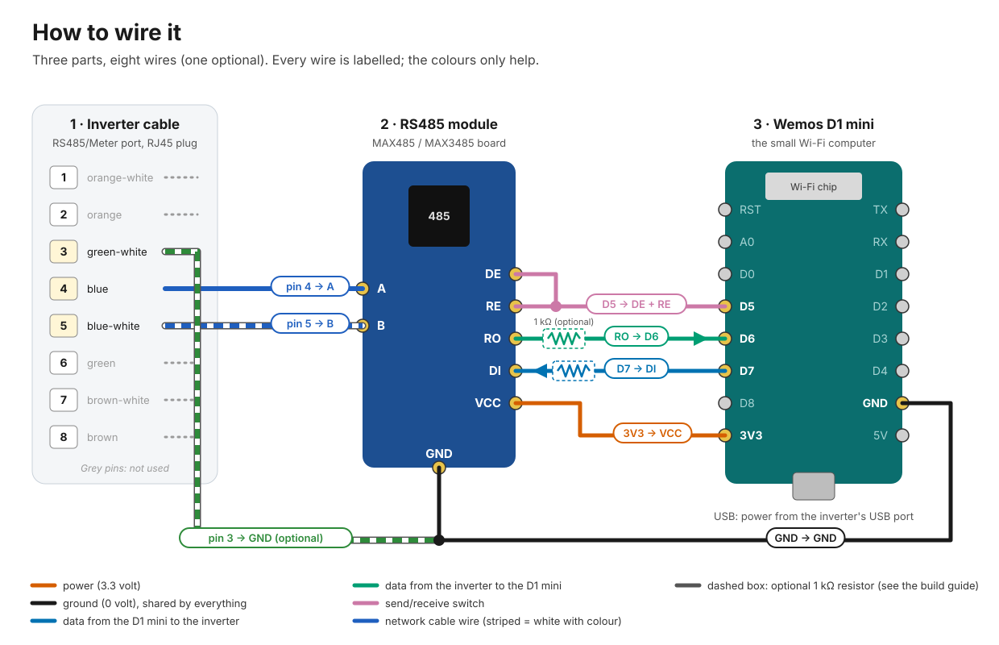

# ☀️ SolaX X1 G3 → Home Assistant, with a €6 Wi-Fi board

This project reads a SolaX X1 Boost, Mini or Air (generation 3) solar inverter over its
RS485 port and puts the
numbers in [Home Assistant](https://www.home-assistant.io/): power per panel string, grid
voltage, today's and lifetime production, and any fault the inverter reports. You don't
need a SolaX cloud account or their Wi-Fi dongle. A Wemos D1 mini and a €2 RS485 module
do the work, over your own Wi-Fi.

If you've never built something like this, you can still do it. There are six or seven
wires to connect, one configuration file to copy, and an *Install* button to press. Each
step says what you should see when it worked. Count on an hour or two and €6–10 in parts.
Soldering is optional.

## 📊 What you get

These are the sensors as they show up in Home Assistant, with values from my inverter on
an October morning:

| Sensor | Example | Notes |
|---|--:|---|
| Inverter Power | 1,626 W | What the inverter delivers to the house and grid. |
| Production Today | 2.7 kWh | Resets every morning. |
| Production Total | 13,275.6 kWh | Lifetime total. Use this one for the Energy dashboard. |
| Power DC1 / DC2, Total DC Power | 234 W / 1,423 W | Per panel string, and both together. |
| PV1 / PV2 Input Voltage and Current | 223.5 V, 6.3 A | Per panel string. |
| Grid Voltage, Grid Frequency, Output Current | 235.6 V, 50.03 Hz | |
| Temperature | 37 °C | Inside the inverter. |
| Run Mode | Normal | Waiting, Checking, Normal, Fault, or Offline at night. |
| Fault | None | Names any fault the inverter reports, like `GridVolt`. |

## 🛒 What you need

| Part | Price (2026) | Notes |
|---|--:|---|
| Wemos D1 mini, or a clone | €3–5 | Any D1 mini with an ESP8266 chip. |
| RS485-to-TTL module | €1–3 | A MAX3485 module is the best fit. The common blue MAX485 module works too ([which one?](docs/build.md#which-rs485-module)). |
| 6–7 female–female jumper wires | €1 | Or solder wires directly. |
| A network cable | €0–3 | An old one is fine; you'll cut one plug off. |
| Micro-USB cable | | Powers the D1 mini from the inverter's USB port (or a phone charger). It has to carry data for the first install. |

You also need a computer with Chrome or Edge for the first install, Home Assistant with
the [ESPHome Device Builder add-on](https://esphome.io/guides/getting_started_hassio/),
wire strippers (or a sharp knife) and a small screwdriver.

## 🧭 Steps

1. [Build the circuit](docs/build.md): connect the module to the D1 mini.
2. [Prepare the inverter and cable](docs/inverter.md): switch on Modbus and make the cable.
3. [Install the software](docs/install.md): put ESPHome on the D1 mini and add it to Home Assistant.
4. [Use the data](docs/home-assistant.md): the Energy dashboard and a few automation ideas.

If something doesn't work, [Troubleshooting](docs/troubleshooting.md) is sorted by what you
see. [How it works](docs/how-it-works.md) explains Modbus and the choices in the
configuration, the [register reference](docs/registers.md) lists every address, and the
[glossary](docs/glossary.md) explains the technical words.

## 🔌 Will it work with my inverter?

I've tested it on an X1 Boost G3 (serial number `XB33…`) with ESPHome 2026.9.1 and Home
Assistant 2026.9. X1 Boost G3 serial numbers usually start with `XB3`, `XAU`, `XBE` or
`XBU`.

The X1 Mini G3 should work as well. The
[SolaX Modbus integration](https://github.com/wills106/homeassistant-solax-modbus) reads it
with exactly the same register addresses, and its users run it with Mini G3 serial
numbers starting with `XM3`, `XM2`, `XMA` and `XAT`.

The X1 Air G3 probably works too. SolaX groups it with the Boost and Mini, but I haven't
found anyone who has actually tried it.

I've only been able to test the Boost myself, so if you have a Mini or an Air, please
[let me know](https://github.com/benjaminvdb/esphome-solax-x1-g3/issues/new/choose) how it
went.

Generation 4 inverters (`XB4…`, `XM4…`) use different addresses, so this config won't
work on them. Hybrid (battery) inverters, the three-phase X3 range and firmware without Modbus
support aren't covered either. For those, have a look at the
[SolaX Modbus integration](https://github.com/wills106/homeassistant-solax-modbus) or
[syssi/esphome-solax-x1-mini](https://github.com/syssi/esphome-solax-x1-mini).

## 🦺 Safety

> [!CAUTION]
> Never open the inverter. It contains high voltages, even when it's switched off.

All you do is plug a network cable into the inverter's communication port, which is there
for meters and monitoring equipment. If the port sits behind a cover you're not sure you
may open, ask your installer. [Step 2](docs/inverter.md#safety) has a bit more on this.

## 📜 History

I wrote the first version of this config in December 2022, for my own X1 Boost, and it
ended up in [aiolos/ESPHome-config](https://github.com/aiolos/ESPHome-config/pull/2)
alongside the Modbus shield I was using. syssi later used it for his
[X1 Boost example](https://github.com/syssi/esphome-solax-x1-mini/blob/main/modbus-examples/esp32-solax-x1-boost.yaml).
This repo continues from there. The biggest fix: the lifetime total used to fall back to 0
after 6,553.5 kWh. The [changelog](CHANGELOG.md) has the rest.

## 🙏 Credits

Thanks to aiolos of [enri.nl](https://enri.nl/pcb/?page=modbus) for the Modbus shield and
for hosting the original config, to [syssi](https://github.com/syssi/esphome-solax-x1-mini)
for the RS485 groundwork and the RJ45 pinout, and to
[wills106](https://github.com/wills106/homeassistant-solax-modbus) and the people around
that project for the register research and for sharing SolaX's protocol document.

## 📄 License

The configuration and scripts are [MIT](LICENSE). The documentation and images are
[CC BY 4.0](https://creativecommons.org/licenses/by/4.0/), so you can share and adapt
them as long as you give credit. Questions and improvements go in the
[issues](https://github.com/benjaminvdb/esphome-solax-x1-g3/issues); see
[CONTRIBUTING.md](CONTRIBUTING.md).
